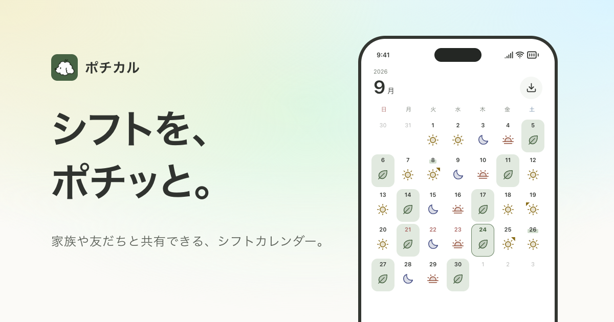

# ポチカル

家族や友だちと共有できるシフトカレンダーです。ポチポチ押していくだけでひと月ぶんのシフトが埋まり、決まった順番のシフトは一度決めれば毎月そのまま入ります。家族や友だちのシフトをひとつの表で見て、休みの合う日をチャットで決められます。

[](https://pochical.app)

- [pochical.app](https://pochical.app)：公式サイト
- [try.pochical.app](https://try.pochical.app)：ブラウザで触れるプロトタイプ
- [design.pochical.app](https://design.pochical.app)：デザインドキュメント

## 見どころ

- **ネイティブ2つとサーバー**：iOSはSwiftUI、AndroidはJetpack Compose、サーバーはCloudflare Workers + Durable Objectsです。グループとユーザーごとにDurable Objectを持ち、通信はProtobufで定義したConnect RPCとWebSocketです。
- **仕様とテストベクタで振る舞いを揃える**：プラットフォームをまたぐ振る舞いは [`spec/`](spec) に書き、各プラットフォームが書き直すロジックは [`spec/vectors`](spec/vectors) のJSONで固定しています。同じJSONを、Webのプロトタイプ、サーバー、iOSのPochicalKit、Androidの `:kit` のテストが読みます。
- **共有の値とデザイントークンは生成する**：文字数の上限やチャット・招待・ウィジェットの決まりなど全プラットフォームで共有する数値、デザイントークン、印のアイコン、祝日は [`design/`](design) に一度だけ書き、`mise run gen` でSwift・Kotlin・TypeScriptのコードを生成します。通信の型も [`proto/`](proto) から同じように生成します。
- **AIと組んで開発**：リポジトリの決まりは [AGENTS.md](AGENTS.md) にまとめ、それに沿ってAIのコーディングエージェントと一緒に開発しています。

## 構成

```text
proto/              通信のスキーマ（Protobuf）。mise run genで各アプリにコードを生成
design/             全プラットフォームで共有する数値・デザイントークン・アイコン・祝日の元
spec/               プラットフォームをまたぐ仕様。vectors/ はそれを固定するテストベクタ
apps/
  ios/              SwiftUIアプリとウィジェット。共有コードはPackages/PochicalKit
  android/          Jetpack Composeアプリ（:app・:kit・:design・:proto）
  server/           Cloudflare Workers + Durable Objects（Connect RPC・WebSocket・D1）
  web/              Astro製の公式サイト。LP・招待・アカウント削除など
  design/           デザインドキュメント（Fumadocs on TanStack Start）
  try/              スマホに置けるプロトタイプ（Vite）
  admin/            運営の管理サイト（React Router）
packages/
  prototype/        プロトタイプの画面。公式サイトのトップも使う
  styled-system/    Panda CSSの設定とcss()
  jsx/              日本語を文節で改行するJSXランタイム
```

## 開発

ツールのバージョンとタスクは [mise](https://mise.jdx.dev) で、TypeScriptのパッケージはpnpm workspacesで管理しています。リポジトリのルートで `mise install` と `pnpm install` を実行します。

| ルートで実行するコマンド | 内容 |
| --- | --- |
| `mise run gen` | `proto/` と `design/` からTypeScript・Swift・Kotlinのコードと、WorkersのTypeScriptの型を生成 |
| `mise run proto:lint` | `proto/` のlintと整形チェック |
| `mise run server` | サーバーの開発環境を `http://localhost:8787` で起動（`-- --port <n>` で別のポート。先に `apps/server/.dev.vars` に `BETTER_AUTH_SECRET=<ランダムな値>` を書き、`apps/server` で `pnpm exec wrangler d1 migrations apply pochical --local` を実行する） |
| `mise run server:test` | サーバーのテストをWorkersのランタイムで実行 |
| `mise run ios:test` | iOSのパッケージのテスト（`spec/vectors` を含む） |
| `mise run android:build` / `mise run android:test` | AndroidのデバッグAPKのビルド / ユニットテストとlint |
| `mise run design` / `mise run try` | デザインドキュメント（`http://localhost:3200`）/ プロトタイプ（`http://localhost:3202`）の開発サーバーを起動 |
| `mise run admin` | 管理サイトの開発サーバーを `http://localhost:3100` で起動 |
| `mise run api:try -- create [名前] [絵文字]` | 本番のサーバーで、匿名ユーザーとしてグループを作り招待リンクを表示する。続けて `join`・`preview`・`remake`、最後に `cleanup` で後片付け（`--local` でローカル） |
| `pnpm run web` | 公式サイトの開発サーバーを `http://localhost:3000` で起動 |
| `pnpm run build:web` / `pnpm run preview:web` | 公式サイトのビルド・プレビュー |
| `pnpm run typecheck` | TypeScriptの全ワークスペースの型チェック |
| `pnpm run test` | TypeScriptの全ワークスペースのテスト |
| `pnpm run check` / `pnpm run fix` | TypeScriptのコードチェック・整形（Ultracite） |

公式サイトの開発・公開設定は [WebのREADME](apps/web/README.md) を参照してください。

## ライセンス

ソースコードは [PolyForm Strict License 1.0.0](LICENSE) で公開しています。読むことや、個人の学習など非商用の目的で使うことはできますが、改変・再配布・商用利用は許可していません。

「ポチカル」「Pochical」の名前、ロゴ、アプリアイコン、キャラクター（PeekingPoodleなど）はこのライセンスの対象外で、使用を許可していません。

同梱しているサードパーティの素材とそのライセンスは [THIRD_PARTY_NOTICES.md](THIRD_PARTY_NOTICES.md) にあります。

## コントリビューション

外部からのプルリクエストは受け付けていません。脆弱性の報告は [SECURITY.md](SECURITY.md) を参照してください。

## リンク

- [pochical.app](https://pochical.app)：公式サイト
- [try.pochical.app](https://try.pochical.app)：プロトタイプ
- [design.pochical.app](https://design.pochical.app)：デザインドキュメント
